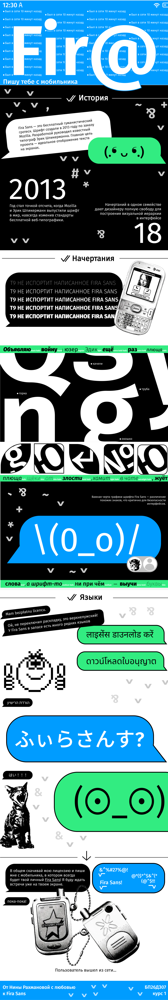

##Учебный проект: 
Вёрстка лендинга о шрифте «Fira sans». Сайт рассказывает историю шрифта, показывает начертания и служит рекламой для его лицензии

## Ссылка на сайт
[Сайт](https://moonlidan.github.io/fira-sans-site/)

## Скриншот

## Автор 
Рахманова Нина БП26ДЗ07

## Что я научился(ась) делать
- [Сверстать одностраничный сайт и повторить свой макет в фигма]
- [Было трудно понять, как строится структура большого кода, пошла на консультацию к преподавателю, который вел у меня код]
- [Новые команды, как быстро заменять элементы в коде с помощью F5, как строится структура кода внутри секций]

## Использование ИИ
### Инструменты

| Инструмент | Для чего использовал(а) | Уровень помощи |
| :--- | :--- | :--- |
| ChatGPT | Объяснил, что такое `letter-spacing` и `br` | 1 |
| Claude | Помог найти, почему не уходят отступы по краям | 2 |
| ChatGPT | Подсказал, как причесать код | 1 |
| ChatGPT | Объяснил разницу между `absolute` и `relative` | 1 |

### Записи о запросах

### Запись №1 [25.10.26]
- **Что я хотела сделать:** Чтобы ушли пустые отступы по краям и снизу макета
- **Что я спросила:** «Как убрать отступы снизу и по бокам, не используя сложные команды и скрипты»
- **Что ответил ИИ:** Сказал обратить внимание на то, как выглядят отступы на сайте в меню разработчика и проверить все ли правила в коде актуальны, а также проверить футер (указал, что он 300px и это может быть одной из причин). 
- **Что я изменила:** Увидела, что старые правила масштаба не работают как надо, заменила `width: 1440` на `width: 100%`; `max-width: 1440`, одна из картинок своим размером создавала прокрутку, я добавила `overflow:clip`, изменила размер футера с 300px на 200px
- **Как проверила:** Перезагрузила страницу и зашла с устройства, масштаб которого позволял увидеть есть ли отступы или нет (кодила с ПК 4к)

###Выводы:

ИИ помог скорректировать структуру кода, чтобы он стал более читаемым, указал, где лежат мусорные куски кода (которые не работают, так как они просто лишние). ИИ иногда ошибался и мог выдать комментарии, которые не совпадают с моим уровнем навывка кодинга, тогда я просто просила переформулировать ответ, либо искала аналог сама. Теперь я знаю, что делать, если формат не соотвествует ожидаемому, где искать ошибки, если не работают определенные правила и что перед каждым коммитом нужно проверять код на наличие мусорных блоков